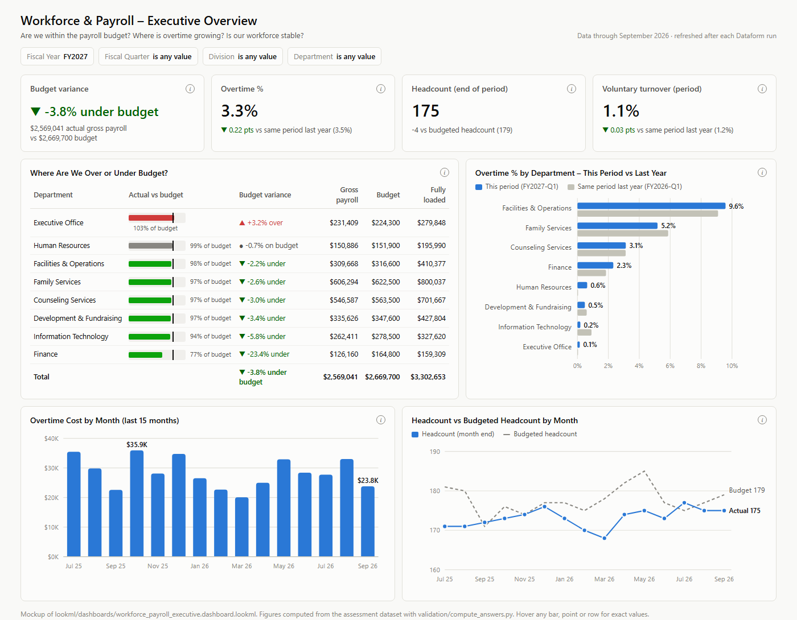

# Workforce & Payroll Analytics — Looker Technical Assessment

A small Looker layer for a leadership team that makes staffing and budget decisions from payroll data:
**BigQuery (bronze) → Dataform (gold) → LookML → executive dashboard.**



## Answers

All four come from the gold layer. They were also recomputed independently from the raw CSVs with
[`validation/compute_answers.py`](validation/compute_answers.py), and both give the same result.

| # | Question | Answer |
|---|---|---|
| 1 | Fully loaded payroll cost in FY2026 | **$14,006,416.09** (gross payroll $10,878,262.41 + employer cost $3,128,153.68) |
| 2 | Highest overtime % in Q1 FY2027 (Jul–Sep 2026) | **Facilities & Operations: 9.58%** ($29,666.87 overtime / $309,668.31 gross). Next: Family Services 5.18% |
| 3 | Voluntary turnover rate in FY2026 | **12.75%** (22 voluntary exits / 172.5 average month-end headcount) |
| 4 | Headcount on September 30, 2026 | **175** (160 full-time + 15 part-time) |

<details>
<summary><b>SQL and Looker queries behind each answer</b></summary>

**1. Fully loaded payroll cost, FY2026**
```sql
SELECT
  SUM(gross_payroll_usd)                     AS gross_payroll,   -- 10,878,262.41
  SUM(employer_cost_usd)                     AS employer_cost,   --  3,128,153.68
  SUM(gross_payroll_usd + employer_cost_usd) AS fully_loaded     -- 14,006,416.09
FROM `payroll_gold.agg_department_monthly`
WHERE fiscal_year = 'FY2026';
```
Looker: Explore *Payroll, Budget & Workforce (monthly)* → filter `Fiscal Year = FY2026` → `Fully Loaded Payroll Cost`.

**2. Highest overtime %, Q1 FY2027**
```sql
SELECT
  d.department_name,
  SAFE_DIVIDE(SUM(a.overtime_usd), SUM(a.gross_payroll_usd)) AS overtime_pct   -- 0.0958
FROM `payroll_gold.agg_department_monthly` AS a
JOIN `payroll_gold.dim_department`         AS d USING (department_id)
WHERE a.fiscal_quarter = 'FY2027-Q1'
GROUP BY d.department_name
ORDER BY overtime_pct DESC
LIMIT 1;
```
Looker: same explore → filter `Fiscal Quarter = FY2027-Q1` → `Department`, `Overtime %`, sorted descending.

**3. Voluntary turnover rate, FY2026**
```sql
SELECT
  SUM(voluntary_exits)                                              AS voluntary_exits,      -- 22
  SUM(headcount) / COUNT(DISTINCT month_start_date)                 AS avg_month_end_hc,     -- 172.5
  SUM(voluntary_exits) / (SUM(headcount) / COUNT(DISTINCT month_start_date)) AS turnover     -- 0.1275
FROM `payroll_gold.agg_department_monthly`
WHERE fiscal_year = 'FY2026';
```
Looker: same explore → filter `Fiscal Year = FY2026` → `Voluntary Turnover Rate`.
Month-end headcounts Jul 2025 → Jun 2026: 171, 171, 172, 173, 174, 176, 173, 170, 168, 174, 175, 173.

**4. Headcount on 2026-09-30**
```sql
SELECT COUNT(*) AS headcount   -- 175
FROM `payroll_gold.fct_headcount_month_end`
WHERE month_end_date = DATE '2026-09-30';
```
The same number straight from the employee dimension, using the definition word for word:
```sql
SELECT COUNT(*)
FROM `payroll_gold.dim_employee`
WHERE employment_type IN ('FULL_TIME', 'PART_TIME')
  AND hire_date <= DATE '2026-09-30'
  AND (termination_date IS NULL OR termination_date > DATE '2026-09-30');
```
Looker: Explore *Workforce (month-end headcount)* → filter `Month End Date = 2026-09-30` → `Headcount`.
</details>

---

## Repository layout

| Path | Content |
|---|---|
| [`definitions/sources/`](definitions/sources) | Declarations of the 5 raw tables (`payroll_raw`, all columns STRING) |
| [`definitions/staging/`](definitions/staging) | Typed and flagged views: nothing is dropped here, so every exclusion is traceable |
| [`definitions/gold/`](definitions/gold) | Gold tables used by Looker |
| [`definitions/assertions/`](definitions/assertions) | Custom assertions, one or more per data issue (built-in ones are in each table's `config`) |
| [`definitions/operations/`](definitions/operations) | `dataform_run_log`: tells Looker a successful run has finished |
| [`includes/fiscal.js`](includes/fiscal.js) | Fiscal calendar helpers shared by all SQLX files |
| [`lookml/`](lookml) | Model, views and the `.dashboard.lookml` file |
| [`mockups/`](mockups) | Dashboard mockup (PNG + HTML) and the script that builds it from real numbers |
| [`validation/`](validation) | Independent pandas check of the cleaning rules and the four answers |
| [`data/raw/`](data/raw) | The 5 CSV files received (synthetic) |

Reproduce the numbers: `python validation/compute_answers.py`. Rebuild the mockup: `python mockups/build_mockup.py`.

---

## Data issues found and how each is handled

| # | Issue | Size | Handling | Guarded by |
|---|---|---|---|---|
| 1 | **VOID lines carry a positive amount**, equal to the original, in a *later* pay run, and point to the original through `voids_line_id`. A replacement line is posted in the same run as the VOID. | 26 VOID lines, $47,944.81 voided | The VOID line **and** the original are both excluded; the replacement stays. Summing everything would double count, and keeping only `POSTED` would still include the voided originals. | `assert_void_lines_resolve` (VOID points to an existing POSTED line of the same employee and amount, voided once) |
| 2 | **Duplicate ingestion**: the same `payroll_line_id` loaded twice with a later `_ingested_at` | 42 rows, $73,160.50 | Keep the first ingestion (`QUALIFY ROW_NUMBER()`) | `uniqueKey` on `fct_payroll_lines`; `assert_duplicate_ingestions_identical` fails if a "duplicate" differs (that would be a correction) |
| 3 | **Amounts with a thousands separator** (`"2,163.20"`) | 780 lines, $1.82M | `REPLACE(',', '')` before casting. A plain `SAFE_CAST` silently turns them into NULL: FY2026 gross would drop from $10.88M to $9.56M | `assert_amounts_parse` (fails on any amount still unreadable after cleaning) |
| 4 | **Test accounts** `TEST-001`, `TEST-002` (job title "Test Account") | 8 lines $12,000; 18 contributions $4,164 | Excluded from all gold tables | `assert_no_test_accounts_in_gold`, `rowConditions` |
| 5 | **Employee file is a snapshot per load**, not one row per employee | 235 rows / 223 employees; 12 department transfers | `dim_employee` = latest snapshot; `dim_employee_department_history` = SCD type 2 (valid_from / valid_to) to know the department on any past date | `uniqueKey`, `assert_department_history_no_overlap` |
| 6 | **Employees without a department** | 4 employees | Filled with the department most recently charged on their payroll lines (flag `is_department_imputed`) | `nonNull` on `dim_employee`, `assert_known_departments` |
| 7 | **Contractors** have no payroll, no FLSA status, hourly rate only | 7 | Kept in `dim_employee`, excluded from headcount and turnover as defined | `counts_in_headcount` flag |
| 8 | **Line department ≠ current employee department** (transfers) | 497 lines | Payroll cost uses the line's department (the definition); headcount and exits use the department on that date (SCD2) | — |
| 9 | **Employer contributions have no department or date** | all 15,743 rows | Date = pay date of the run; department = the one charged on the employee's lines in that run | `assert_one_department_per_employee_run`, `assert_contributions_match_payroll` |
| 10 | Budget completeness and fiscal labels | — | All 120 rows were consistent; checked anyway because budget variance depends on it | `assert_budget_complete` |

Net effect: a naive `SUM(amount_usd)` over the raw file gives **$181,050 more** than the clean gross payroll (or $1.3M *less* if the comma amounts are cast to NULL).

`dataform_run_log` depends on all custom assertions, so **Looker only refreshes its cache after a run whose checks passed**.

## Assumptions

Questions were not sent because of timing, so each assumption is stated here.

1. **Valid earning line** = `POSTED`, not voided by a VOID line, first ingestion of its `payroll_line_id`, not a test account.
2. **Voids restate the original month.** The voided amount is removed from the month of the original line, not from the month of the VOID. This matches "sum of all valid earning lines, assigned to the month of pay_date".
3. **Employer cost** is assigned to the month of the pay run's pay date and to the department charged on that employee's lines in the run. Contributions of runs whose lines were partly voided are kept in full: the void/replacement pairs are corrections, and the run was still paid.
4. **Headcount by department** uses the department the employee belonged to on that day. An employee's first known department applies to all dates before the first load (2025-06-30). Transfers take effect on the load date of the new snapshot.
5. **Voluntary turnover** counts full-time and part-time employees only, so the numerator and the denominator cover the same population. For a period, the denominator is the average of each month-end headcount in the period. It is not annualized.
6. **Raw tables are loaded into BigQuery with every column as STRING** (a safe bronze load). This is why the cleaning casts explicitly.
7. **Fiscal year** is named after the year it ends (FY2026 = July 2025–June 2026), as in the brief and the budget file.
8. **"Average salary by job title"** = FTE-annualized base pay: annual salary, or hourly rate × 2,080. It covers current full-time and part-time staff.

## Concerns about the business definitions (implemented as written)

- **Gross payroll by pay-date month vs. a flat monthly budget.** Pay runs are biweekly, so October 2025 and May 2026 contain 3 pay dates. Those months show **+40% over budget** while the others show about −7%. Quarterly and yearly views are fine, but a monthly variance tile would raise false alarms twice a year. Better options: phase the budget by number of pay dates, or report payroll on an accrual basis (pay period days). I kept the definition and made the dashboard default to fiscal year / quarter.
- **Voluntary turnover per quarter is not annualized**, so a quarterly rate (~1.1%) and a yearly rate (~12.8%) look very different on the same dashboard. I label it "(period)". An annualized version would be a one-line change.
- **Headcount excludes contractors, but contractor cost is not in payroll at all.** Fully loaded cost therefore understates workforce cost if contractors are paid through accounts payable.
- **Restating voided lines changes past months.** A report already sent for a closed month can change after a void. If Finance closes months, voids should instead be booked as a reversal in the month of the VOID. Each rule is a one-line change in `stg_payroll_lines`.

---

## Part 1 — Gold layer (Dataform)

| Table | Grain | Purpose |
|---|---|---|
| `fct_payroll_lines` | one valid earning line | Gross payroll, overtime. Partitioned by `pay_date`, clustered by department / earning type |
| `fct_employer_contributions` | run × employee × contribution type | Employer cost, with pay date and cost department attached |
| `dim_employee` | one current row per employee | Attributes and pay rates (pay rates only visible to HR / Finance in Looker) |
| `dim_employee_department_history` | employee × validity range | Department on any past date (SCD type 2) |
| `dim_department` | department | Name, division, cost center, manager |
| `fct_headcount_month_end` | employee × month end | Who was active on each month end, with their department that day |
| `agg_department_monthly` | department × month | Gross payroll, employer cost, overtime, headcount, exits, budget, and the same month last year. Feeds the dashboard |

## Part 2 — LookML model

**Explores and join choices**

1. **`department_monthly`** (dashboard explore). Every metric is pre-aggregated in Dataform to the same grain (department × month), so the only join is `departments` (`many_to_one`). There is **no fan-out by design**, and every total is right at any level of detail.
2. **`payroll_lines`** (detail explore). This one joins all five sources:
   - `departments` uses `many_to_one` on the line's cost center.
   - `employer_contributions` uses `many_to_many` on (pay run, employee): one employee has several lines and three contributions in the same run. Both views declare a primary key, so Looker applies **symmetric aggregates** and neither the line totals nor the contribution totals are inflated.
   - `budget` uses `many_to_one` on (department, month), with a primary key so the budget is not repeated once per line.
   - `employees` uses `many_to_one` and requires the HR / Finance access grant on the join itself, so nobody else can break pay down by person.
3. **`headcount_month_end`**: the workforce explore. It joins `departments` and `employees`, and pay fields carry their own grant.
4. **`salary_by_job_title`**: see Part 4.

**Snapshot metrics.** Headcount is a point-in-time number and cannot be summed over months. The `headcount` measure collects the (month, headcount) pairs of each result row with `ARRAY_AGG` and adds up only the latest month. A quarter therefore shows the headcount on its last day, matching the definition. The turnover denominator uses `SUM(headcount) / COUNT(DISTINCT month)` = the average month-end headcount.

**Fiscal year.** `fiscal_month_offset: -6` in the model makes Looker's `fiscal_year` / `fiscal_quarter` timeframes start in July of the previous year (FY2026 = Jul 2025–Jun 2026). The gold tables also carry ready-made labels (`FY2026`, `FY2027-Q1`), so business users filter by a plain dropdown.

**For business users.** Every visible field has a label and a description. Keys, raw columns and helper dimensions are hidden. Main measures have drill sets that stay at department / month / earning-type level, so a drill never exposes one person's pay.

## Part 3 — Executive dashboard

[`lookml/dashboards/workforce_payroll_executive.dashboard.lookml`](lookml/dashboards/workforce_payroll_executive.dashboard.lookml): 8 tiles. Filters: Fiscal Year (default FY2027), Fiscal Quarter, Division, Department.

| Tile | Question | Why this chart type |
|---|---|---|
| Payroll vs Budget (KPI) | Within budget? | Single value: it is a yes/no question. Liquid colors the variance and adds words (over / under / on budget), so the meaning never depends on color alone |
| Overtime % (KPI) | Overtime trend | Single value with change vs the **same period last year** (avoids seasonality); colors reversed because an increase is bad |
| Headcount (KPI) | Workforce size | Single value at the end of the period vs budgeted headcount |
| Voluntary Turnover (KPI) | Workforce stability | Single value vs same period last year, colors reversed |
| Where are we over or under budget? | Where not within budget | Table with an **in-cell bullet bar** (custom element): spend against each department's own budget line, sorted worst first, with amounts |
| Overtime % by department vs last year | Where is overtime growing | Sorted horizontal bars: names stay readable, ranking answers "where", the grey bar shows growth |
| Overtime cost by month | How much does overtime cost | Columns in dollars, full history (ignores the period filters on purpose: growth is a trend question) |
| Headcount vs budgeted headcount by month | Is the workforce stable | Two lines on one scale: stability = a flat line tracking its budget |

There is no dual-axis chart anywhere: overtime dollars and overtime % are in separate tiles rather than on two competing scales.

**Liquid customization.** `budget_variance_pct` uses conditional color, an arrow and words. `budget_bullet` builds the bullet bar.

**Custom visual element: the bullet bar.** A standard Looker table can color a cell, but it cannot draw a bar with a target marker. The bullet shows three things in one cell: actual, budget line, and over/under color.

Why it is worth its maintenance cost:
- It is about 10 lines of HTML in one measure: no JavaScript, no custom-visualization server, no extra deployment.
- It is version-controlled with the model.
- It works in any table, drill, scheduled PDF or e-mail where the field is used.

The cost is that the HTML must be kept in sync if the scale changes, and CSV downloads show only the number. A full custom JS visualization would cost far more to own for the same information.

## Part 4 — Security and performance

**Row-level security.** Managers see only their own department. Each explore has an `access_filter` tied to the user attribute `allowed_department_ids`:
- Managers get their department id, e.g. `D04` (the attribute can be populated from `dim_department.manager_employee_id` through SSO / SCIM).
- HR, Finance and Leadership get `%`, which matches every department.

The filter targets the cost department for payroll and the department-on-that-date for headcount.

**Column-level security.** Salary and hourly rate are visible only to HR and Finance through `access_grant: can_see_individual_pay` (user attribute `payroll_access_role` ∈ {hr, finance}):
- Salary, hourly rate, annualized pay and e-mail are hidden from everyone else.
- In the payroll explore, the entire `employees` join requires the grant, so a manager cannot group their department's payroll by person.
- Managers can still list the people in their department (name, title, hire date) in the workforce explore, just without pay.

**"Average salary by job title" without exposing individuals.** It is delivered as a PDT ([`salary_by_job_title.view.lkml`](lookml/views/salary_by_job_title.view.lkml)) and has its own explore with no grant:
- The table is aggregated before Looker sees it, so no row for an individual exists and no drill can reach one.
- Titles held by fewer than 5 people are pooled into "Other titles". The pooled group is dropped too if it is under 5. This applies to single-person titles such as Controller, Clinical Director or Chief Executive Officer.
- There is no department dimension, so groups cannot be sliced smaller.
- Averages are rounded to the nearest $1,000.

**Performance and caching.**
- The dashboard reads the ~120-row `agg_department_monthly`, pre-aggregated by Dataform, instead of 9,000 lines.
- Fact tables are partitioned by `pay_date` and clustered by department.
- Aggregate awareness: the `payroll_lines` explore has an `aggregate_table` at month × department, so ad-hoc monthly queries skip the line table.
- The salary-by-title PDT and the aggregate table are rebuilt on the datagroup.

How the cache refreshes when Dataform finishes a run:
1. The Dataform run ends with the `dataform_run_log` operation. It depends on every gold table and every custom assertion, so it inserts a row only after a successful run.
2. The Looker datagroup `payroll_gold_refresh` runs `SELECT MAX(finished_at) FROM payroll_gold.dataform_run_log` on the PDT regenerator schedule. That is a tiny, cheap query.
3. When the value changes, Looker invalidates the cache of all queries that use `persist_with: payroll_gold_refresh` and rebuilds the PDT and aggregate tables.
4. `max_cache_age: 24 hours` is a safety net.

For an instant refresh, the Dataform workflow could also call the Looker API to reset the datagroup.

## What I would do next with more time

- Run everything against a BigQuery sandbox and a Looker dev instance. The SQL and LookML were written and reviewed but **not executed**: the numbers come from the pandas check, which applies the same rules.
- Ask the client the four open questions above (void restatement, 3-paycheck months, contractors, turnover annualization).
- Write-audit-publish in Dataform: build to a staging dataset and swap only if assertions pass, so a failed check never leaves half-updated gold tables.
- Make `agg_department_monthly` incremental and add a fiscal calendar table (holidays, pay-date counts per month for budget phasing).
- Add LookML data tests (`test:`) that pin the four answers, so a model change that breaks them fails in CI.
- Validate the dashboard with two or three executives (the 10-second test), and add a monthly scheduled PDF.

## AI usage

I used Claude (Anthropic) through Claude Code as a pair programmer for:
- profiling the CSVs to find the data issues
- drafting the Dataform SQLX and LookML files
- writing the pandas validation script and the mockup generator
- drafting this README

I made the business decisions and assumptions, and reviewed every file. The four answers were cross-checked with an independent script.
